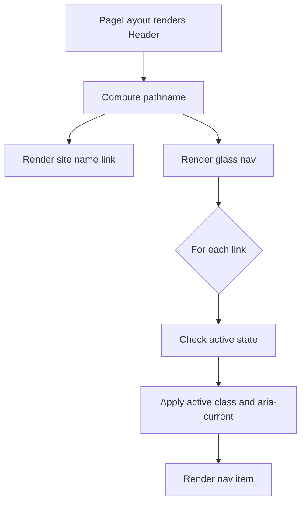

# Header Component Documentation

## Current State

**File:** `src/components/Header.astro`

### Structure
- Top-level site header rendered on every page via `PageLayout`.
- Left side: site name (`SITE.NAME`) linking to home (`/`), no underline.
- Right side: floating "glass" pill navigation with links to `/blog`, `/work`, `/projects`.

### Active Link Detection
- A nav item is marked active when the current pathname equals its href or starts with `${href}/` (supports nested routes).
- Active item sets `aria-current="page"`.

### Styling
- Glassmorphism nav: blurred translucent background, rounded pill, subtle border + shadow.
- Hover/active states adjust background and text color.
- Dark mode: overrides `glass-nav` background/border and `nav-item` colors via `:global(.dark)` selectors.
- Responsive: below 480px the header stacks vertically and nav items shrink.
- Motion: respects `prefers-reduced-motion` by disabling nav-item transitions.

### Accessibility
- Nav has `aria-label="Main navigation"`.
- Active item sets `aria-current="page"`.

---

## Implementation Plan: Make the Header Elegant

### Goals
- Elevate visual polish while keeping the glassmorphism identity.
- Improve responsiveness, accessibility, and motion handling.
- Keep changes minimal and aligned with existing Tailwind + Astro setup.

### Steps

1. **Refine typography & spacing**
   - Use a consistent type scale for the site name and nav items.
   - Increase horizontal padding on nav items for better tap targets (min 44px).

2. **Enhance glass effect**
   - Add subtle gradient border and inner highlight.
   - Adjust blur and opacity for better contrast in both light/dark modes.

3. **Improve active state**
   - Add a sliding indicator (animated underline/pill) that moves between active items.
   - Use `transition` on transform for smooth movement.

4. **Mobile experience**
   - Convert nav to a collapsible menu (hamburger) below 640px instead of stacking.
   - Add focus trap and escape-to-close for accessibility.

5. **Accessibility upgrades**
   - Add skip-to-content link.
   - Ensure keyboard navigation order and visible focus rings.
   - Add `aria-expanded` / `aria-controls` for mobile toggle.

6. **Motion & performance**
   - Respect `prefers-reduced-motion` for all transitions including the sliding indicator.
   - Avoid layout shift by reserving space for nav.

7. **Dark mode polish**
   - Tune glass-nav opacity and border for OLED-friendly contrast.
   - Ensure text contrast meets WCAG AA.

8. **Testing**
   - Verify active states on nested routes.
   - Test keyboard navigation and screen reader announcements.
   - Check responsive breakpoints (320px, 480px, 640px, 768px).

### Mermaid: Header Component Flow

### Notes
- Keep `SITE.NAME` and link list configurable via `src/consts.ts`.
- Avoid introducing new dependencies; use Astro + Tailwind + vanilla CSS.